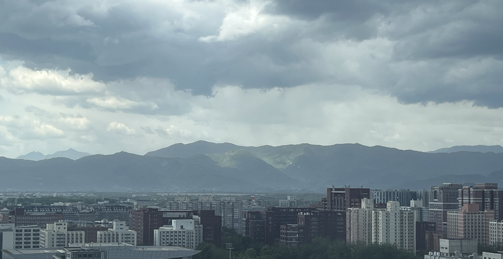

## 👋 Hi, I'm Yi Duan (段毅)

I'm a senior undergraduate at **Renmin University of China**, joining the **Gaoling School of Artificial Intelligence** for an M.S. in 2027.

Most of my time goes into agents that can actually do research — read a paper, find the official repository, reproduce the experiment, write down what happened. That loop is what I care about most (**AI scientists**), together with what happens when a system starts editing the loop itself (**recursive self-improvement**). On the applied side I work on **genomic foundation models** for regulatory DNA, where the interesting question is whether the reasoning behind a prediction survives contact with a wet-lab assay.

- 🔭 **Now** — Paper2Agent: paper → pinned repo → isolated environment → MCP tools
- 🧬 **Also** — R3LM, a reasoning interface between LLMs and regulatory DNA
- 📫 **Say hi** — [2023200660@ruc.edu.cn](mailto:2023200660@ruc.edu.cn)

   

 

## 💻 Code

<table>
<tr>
<td width="50%" valign="top"><b><a href="https://github.com/DuanYi516/R3LM">R3LM</a></b>  mine · KDD 2026 LLMs read regulatory DNA through motif-grounded, structured reasoning.</td>
<td width="50%" valign="top"><b><a href="https://github.com/yangzhao1230/Prism">Prism</a></b>  co-first author · ICLR 2026 Oral Official code for fusing epigenomic signals with sequence to predict gene expression.</td>
</tr>
<tr>
<td width="50%" valign="top"><b><a href="https://github.com/QizhiPei/BioMatrix">BioMatrix</a></b>  co-first author One token space for sequences, structures and language; I built 39 of the 80 evaluation tasks.</td>
<td width="50%" valign="top"><b><a href="https://github.com/theseus-labs-rsi/awesome-rsi">awesome-rsi</a></b>  contributor Curated reading list on recursive self-improvement, companion to <i>The Last AI Built by Humans</i>.</td>
</tr>
<tr>
<td width="50%" valign="top"><b><a href="https://github.com/opendatalab/Sciverse-Agent-Tools">Sciverse-Agent-Tools</a></b>  contributor Tool schemas and SDKs that hand Sciverse scientific retrieval to LLM agents.</td>
<td width="50%" valign="top"><b><a href="https://github.com/DuanYi516/jaspar-cre-reasoner">jaspar-cre-reasoner</a></b>  mine R3LM as a skill: JASPAR/FIMO evidence → context card → trace you can read.</td>
</tr>
<tr>
<td colspan="2" valign="top"><b><a href="https://github.com/DuanYi516/terminal-bench-science">terminal-bench-science</a></b> fork Benchmark harness for AI agents on end-to-end research workflows across scientific domains.</td>
</tr>
</table>

 

## 📄 Papers

<table>
<tr>
<td align="center" width="25%"> <b>ICLR 2026</b> Oral · top 1.15% Prism</td>
<td align="center" width="25%"> <b>KDD 2026</b> Research track R3LM</td>
<td align="center" width="25%"> <b>ACL 2026</b> Main conference R3</td>
<td align="center" width="25%"> <b>NeurIPS 2025</b> 2nd prize CURE-Bench</td>
</tr>
</table>

PDFs, abstracts and the full author lists are on the [homepage](https://duanyi516.github.io/#publications).

 

  Beijing, China · <a href="https://duanyi516.github.io/">duanyi516.github.io</a> · 欢迎邮件交流 
  Most of my work lives in private repos until it ships; what's public is above.

  
  

